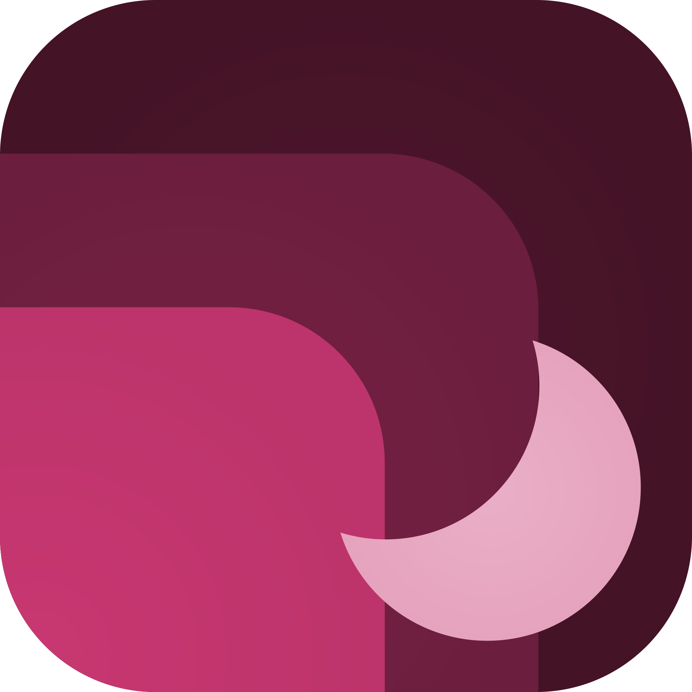

# NightlyLauncher

Automatic updates for all of your favorite apps

## :cd: Installation

> [!IMPORTANT]
> The Windows versions require the [Microsoft Visual C++ Redistributable](https://learn.microsoft.com/en-us/cpp/windows/latest-supported-vc-redist) to be installed.

You can download the latest version from the [releases page](https://github.com/nxtroox/NightlyLauncher/releases/latest).

## :bulb: Usage

> [!TIP]
> You can configure everything from the UI and do not need to edit config files manually.

1. Add a repository. *(Open sidebar menu → 'Repositories' → 'Add')*
2. Add an app. *(Open sidebar menu → 'App Browser' → Double-click on the app you want to install)*
3. (optional) Configure the app. *(Open sidebar menu → 'Library' → Right-click on the app → 'Edit')*
4. The app will always update automatically when you launch it. *(Open sidebar menu → 'Library' → Double-click an app to launch it)*

Check out the [documentation](docs) if you have any questions.

## :robot: AI Disclaimer

This project was created by human developers. It was **not** vibe coded.

However, AI was used to answer questions, suggest improvements and for debugging purposes, helping to speed up the development process.

All AI-generated content was and will continue to be manually reviewed, tested and improved by humans (who actually know what they are doing).

## :scroll: License

This project is licensed under the [GPL-3.0 License](LICENSE).
